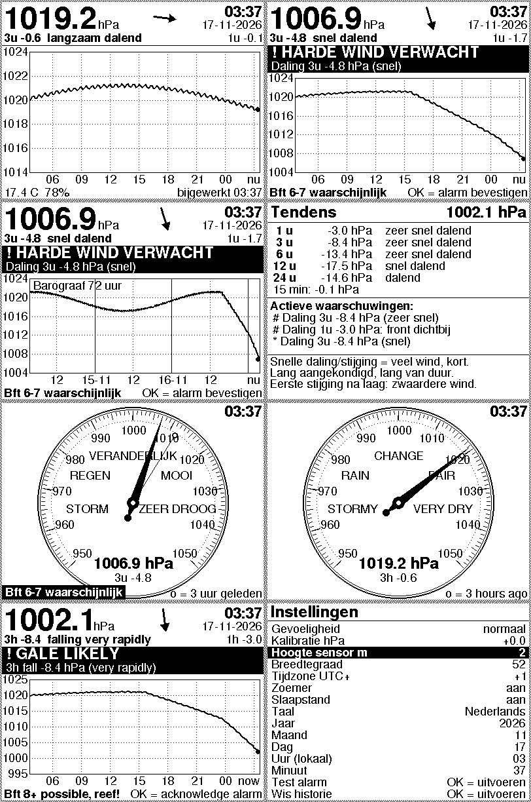

# Barograaf met stormalarm – Elecrow CrowPanel ESP32 4.2" e-paper

Zelfstandige barograaf voor aan boord van een zeiljacht. Meet elke minuut de
luchtdruk, tekent een barogram van 24 uur en 72 uur op het e-paper scherm en
geeft een alarm (zoemer en LED) bij drukveranderingen die op harde wind wijzen.
Een DS3231-klok met eigen batterij zorgt dat tijd en historie kloppen, ook na
een stroomonderbreking.



---

## 1. Hardware

| Onderdeel | Opmerking |
|---|---|
| Elecrow CrowPanel ESP32 4.2" E-Paper HMI (ESP32-S3, 400×300, SSD1683) | Scherm, 5 knoppen, USB-C |
| Druksensor **BME280** (standaard) of **BMP390** | I2C, adres 0x76 (of 0x77). BMP390 is nauwkeuriger. |
| **DS3231** RTC-module met CR2032 | I2C, adres 0x68 |
| Actieve zoemer 5 V/12 V + N-MOSFET (bijv. AO3400) of transistor | Luid genoeg voor in de kuip |
| (optioneel) alarm-LED + 330 Ω | Of de LED op het bord |
| 12 V → 5 V DC-DC-omzetter | Voeding vanaf de boordaccu, via zekering |

### Bedrading (zie `include/config.h`)

| Signaal | ESP32-S3 GPIO | Naar |
|---|---|---|
| I2C SDA | 15 | BME280 SDA, DS3231 SDA |
| I2C SCL | 16 | BME280 SCL, DS3231 SCL |
| 3V3 / GND | header | VCC/GND van beide modules |
| Zoemer | 14 | gate van de MOSFET (100 kΩ pull-down naar GND) |
| LED | 41 | LED + weerstand (of `LED_PIN -1`) |

Het scherm en de knoppen zitten al op het bord:
EPD MOSI 11, SCK 12, CS 45, DC 46, RST 47, BUSY 48, schermvoeding 7;
knoppen HOME 2, EXIT 1, draaischakelaar omhoog 6 / omlaag 4 / indrukken 5.

> **Controleer de pinnen** met het schema van jouw bordversie. De nummers volgen
> de voorbeeldcode van Elecrow. Kies voor I2C pinnen die op de GPIO-header van
> jouw bord zitten en pas `I2C_SDA`/`I2C_SCL` aan als dat nodig is. Vermijd
> GPIO 19/20 (USB).

**Tips voor aan boord**
- Zet de sensor **binnen**, uit de zon en weg van de kachel en de motor, en niet
  in een luchtdichte doos. Een kleine opening of een stukje Goretex is genoeg.
- DS3231-modules (ZS-042) hebben een laadcircuit voor een LIR2032. Gebruik je
  een gewone CR2032? Verwijder dan de laaddiode/weerstand. Haal ook de power-LED
  van de module weg; dat scheelt stroom.
- Coat de printen tegen vocht en zout (conformal coating), maar niet de
  sensoropening.

---

## 2. Bouwen en flashen

```bash
cd esp21-barograaf-barometer
pio run                 # compileren
pio run -t upload       # flashen via USB-C
pio device monitor      # seriële console, 115200 baud
make -C test            # unit-tests van de trend- en alarmlogica (op de pc)
```

- Gebruik je de **BMP390**? Zet dan in `include/config.h` `SENSOR_BMP390` aan en
  `SENSOR_BME280` uit.
- Komt er geen seriële uitvoer en gebruikt jouw bord een USB-UART-chip? Zet dan in
  `platformio.ini` `ARDUINO_USB_CDC_ON_BOOT=0`.
- Lukt flashen niet? Houd BOOT ingedrukt, druk kort op RESET en laat BOOT los.

**Schermvoorbeeld op de pc** (gebruikt dezelfde tekencode als de firmware):
```bash
git clone https://github.com/adafruit/Adafruit-GFX-Library ../Adafruit-GFX-Library
make -C tools run       # maakt PNG's van alle schermen in tools/
```

---

## 3. Bediening

| Knop | Op een grafiekscherm | In Instellingen |
|---|---|---|
| **OK** (draaiknop indrukken) | alarm bevestigen / scherm verversen | waarde wijzigen aan/uit, actie uitvoeren |
| **Omhoog / Omlaag** | vorig / volgend scherm | regel kiezen, of waarde aanpassen |
| **HOME** | terug naar hoofdscherm | opslaan en terug |
| **EXIT** | naar Instellingen | opslaan en terug |

Bij een alarm dat nog niet bevestigd is, **bevestigt de eerste druk op een
willekeurige knop het alarm**.

**Schermen**
1. **Hoofdscherm**: actuele druk (herleid naar zeeniveau), tendenspijl,
   verandering over 3 uur en 1 uur, alarmbalk en barogram van 24 uur.
2. **Barograaf 72 uur**: middernacht is gemarkeerd met een doorgetrokken lijn.
3. **Tendens**: tabel met de verandering over 1, 3, 6, 12 en 24 uur, de
   druksprong over 15 minuten, de actieve waarschuwingen en een paar vuistregels.
4. **Klassieke barometer**: wijzerplaat van 950 tot 1050 hPa met de bekende
   woorden STORM, REGEN, VERANDERLIJK, MOOI en ZEER DROOG op de traditionele
   plaatsen (28,5 tot 30,5 inHg). De zwarte wijzer geeft de huidige druk. De
   dunne wijzer met het open rondje is de "meewijzer": die staat op de druk
   van 3 uur geleden. Vroeger zette je die met de hand; hier gaat dat
   automatisch. Zo zie je in één oogopslag of de druk daalt of stijgt.
5. **Instellingen**: gevoeligheid, kalibratie, sensorhoogte, breedtegraad,
   tijdzone, zoemer, slaapstand, taal (NL/EN), datum en tijd, alarmtest en
   historie wissen.

Het apparaat slaapt tussen de metingen (deep sleep). Het scherm wordt elke 10
minuten ververst, bij elke wijziging van het alarmniveau, en na een druk op een
knop. Na 45 seconden zonder bediening keert het terug naar het hoofdscherm en
gaat het weer slapen. Is een computer via USB aangesloten, dan blijft het
apparaat wakker.

### Seriële commando's (115200 baud)
```
STATUS                       metingen, trends, alarmstatus
TIME 2026-11-15 14:30:00     RTC zetten (UTC!)
DUMP                         historie als CSV (epoch_utc,hPa)
SIM                          demo-depressie laden (scherm- en alarmtest)
CLEAR                        historie wissen
TEST                         alarmtest (8 s)
SAVE                         historie en instellingen nu opslaan
```

---

## 4. Alarmlogica

De trends worden berekend met lineaire regressie over alle metingen in het
tijdvenster, niet als "nu min toen". Zo hebben windvlagen, dichtslaande luiken
en golfslag weinig invloed. De druk wordt elke minuut gemeten (gemiddelde van 4
metingen). Elke 10 minuten komt er een punt in de 72-uurshistorie.

| Niveau | Regel (gevoeligheid "normaal") | Betekenis |
|---|---|---|
| 1 – LET OP | daling ≥ 2,0 hPa/3u, of stijging ≥ 3,0 hPa/3u | wind kan toenemen (Bft 5-6) |
| 2 – HARDE WIND | daling ≥ 3,6 hPa/3u (WMO "snel dalend") | Bft 6-7 waarschijnlijk |
| 2 | stijging ≥ 4,5 hPa/3u | harde, vlagerige wind achter het koufront |
| 2 | daling ≥ 1,5 hPa in 1 uur | front of trog nadert |
| 2 | druksprong ≥ +1,0 hPa binnen 15 min | buienlijn of onweer met valwinden |
| 2 | daling ≥ 10 hPa in 12 uur | diepe depressie op komst |
| 3 – STORM | daling ≥ 6 hPa/3u (WMO "zeer snel dalend") | Bft 8+ mogelijk |
| 3 | stijging ≥ 6 hPa/3u | |
| 3 | daling ≥ 2,5 hPa in 1 uur | front dichtbij |
| 3 | daling ≥ 24 hPa·sin(φ)/sin(60°) in 24 uur | "weerbom" (≈ 21,8 hPa op 52° N) |

- **Gevoeligheid**: *gevoelig* = drempels × 0,75, *normaal* = × 1,0,
  *ruim* = × 1,3.
- **Hysterese**: een regel gaat pas uit als de waarde onder 75 % van de drempel
  zakt. Zo flappert het alarm niet aan en uit.
- **Zoemer**:
  - Niveau 1 geeft eenmalig twee korte piepjes.
  - Niveau 2 en 3 geven 90 seconden lang een doorlopend patroon (3 = snel
    ritme). Daarna volgt elke minuut een korte herinnering, totdat iemand het
    alarm bevestigt.
  - Loopt het alarm op naar een hoger niveau, dan gaat de zoemer opnieuw.
  - Zakt het alarm eerst en loopt het daarna weer op, dan gaat de zoemer ook
    opnieuw.
- Hoogte en kalibratie worden pas bij de weergave opgeteld. Een andere
  kalibratie geeft daarom nooit een vals sprong-alarm.

> **Dit is een hulpmiddel, geen vervanging van het officiële weerbericht,
> Navtex of het KNMI-/Meteo-bericht voor de scheepvaart.**

---

## 5. Checklists

### 5.1 Ingebruikname (DO-CONFIRM, eenmalig)
- [ ] Pinnen in `config.h` gecontroleerd tegen het schema van het bord
- [ ] Sensor- en RTC-adres gecontroleerd (`STATUS` toont `sensor ok` en `DS3231`)
- [ ] RTC op **UTC** gezet (`TIME …` of via Instellingen); `STATUS` toont `valid`
- [ ] Tijdzone ingesteld (NL: +1 winter / +2 zomer)
- [ ] Sensorhoogte boven de waterlijn ingevuld
- [ ] Kalibratie vergeleken met een officiële waarneming in de buurt (zelfde uur,
      herleid naar zeeniveau) en het verschil ingevuld
- [ ] Breedtegraad van het vaargebied ingevuld
- [ ] **Alarmtest** uitgevoerd (Instellingen → Test alarm): zoemer hoorbaar in de
      kuip en in de kooi
- [ ] `SIM` uitgevoerd: barogram, tendenspijl en alarmbalk getoond; daarna `CLEAR`
- [ ] Voeding via zekering; apparaat gaat na een stroomonderbreking weer verder
      (historie wordt elk uur in flash bewaard)

### 5.2 Voor vertrek (READ-DO, elke tocht)
- [ ] Tijd op het scherm klopt; geen `TIJD?` of `SENSOR FOUT`
- [ ] Barogram loopt door zonder gaten
- [ ] Zoemer staat **aan**
- [ ] Gevoeligheid past bij de tocht (*gevoelig* voor een oversteek of een
      lagerwal-kust)
- [ ] Officieel weerbericht gelezen en naast het barogram gelegd

### 5.3 Bij alarm (READ-DO)
1. [ ] Alarm bevestigen (willekeurige knop)
2. [ ] Scherm **Tendens** lezen: welke regel is actief, en daalt of stijgt de druk?
3. [ ] Actueel weerbericht ophalen (marifoon, Navtex, internet)
4. [ ] Plan bepalen: reven, zeilvoering verkleinen, koers of haven wijzigen
5. [ ] Bemanning briefen, reddingsvesten en lijflijnen klaarleggen, dek opruimen
6. [ ] Bij een **druksprong of buienlijn**: direct reven, windstoten en
       windsprong verwachten
7. [ ] Bij een **snelle stijging na een laag**: harde NW-wind achter het front
       verwachten
8. [ ] Barogram elk uur volgen totdat het alarm vervalt

### 5.4 Periodiek (maandelijks / begin seizoen)
- [ ] Kalibratie controleren tegen een officiële waarneming
- [ ] Batterij van de DS3231 controleren (voor een nieuw seizoen vervangen)
- [ ] Alarmtest uitvoeren
- [ ] Connectoren en print controleren op corrosie

---

## 6. Projectstructuur

```
esp21-barograaf-barometer/
├── platformio.ini            build-configuratie (ESP32-S3, Arduino)
├── include/config.h          pinnen en instelbare constanten
├── lib/BaroCore/src/         hardware-onafhankelijke kern
│   ├── baro_series.h         ringbuffer met vaste tijdstap (gaten bij uitval)
│   ├── baro_trend.h          regressietrends, WMO-tendens, druksprong
│   └── baro_alarm.h          alarmregels, hysterese, bevestigen
├── src/
│   ├── main.cpp              meetcyclus, deep sleep, knoppen, zoemer, serieel
│   ├── display.cpp/.h        schermen incl. klassieke wijzerplaat (Adafruit GFX)
│   ├── sensors.cpp/.h        BME280/BMP390 en DS3231
│   ├── storage.cpp/.h        instellingen (NVS) en historie (LittleFS)
│   ├── strings.h             teksten NL/EN
│   └── app_state.h           gedeelde datastructuren
├── test/                     unit-tests op de pc (make -C test)
└── tools/                    schermpreview op de pc (make -C tools run)
```

## 7. Status en beperkingen
- De unit-tests van de alarmlogica slagen op de pc.
- De firmware compileert foutloos tegen arduino-esp32 2.0.17 voor de ESP32-S3,
  met GxEPD2, Adafruit GFX, BME280/BMP3XX en RTClib.
- De schermen zijn op de pc gecontroleerd.
- **De firmware is nog niet op echte hardware getest.** Controleer bij de eerste
  ingebruikname vooral de pinnen, de wake-up via de knoppen en de verversing
  van het scherm.
- De druk in de kajuit kan kort afwijken door de wind (venturi-effect over
  luiken). Daarom wordt er gemiddeld en met regressie gerekend; extreme pieken
  kunnen toch een druksprong-alarm geven.
- Na een stroomonderbreking gaat hooguit het laatste uur aan historie verloren.
